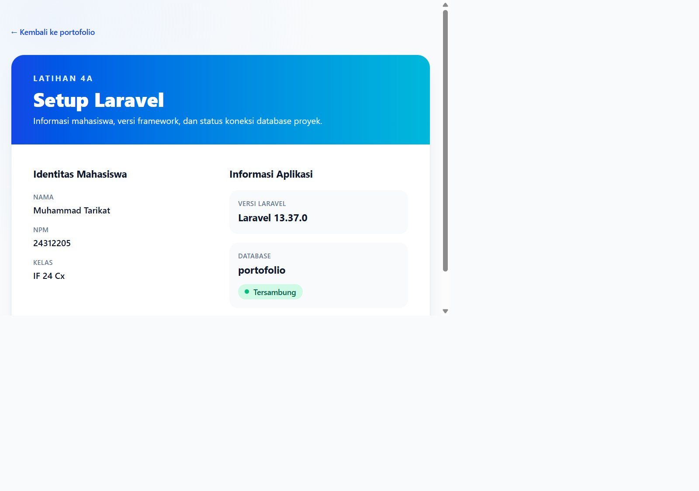

# Latihan 4a — Setup Laravel

## Identitas Mahasiswa

| Keterangan | Data |
|---|---|
| Nama | Muhammad Tarikat |
| NPM | 24312205 |
| Kelas | IF 24 Cx |
| Branch | `Lat-4a_SetupLaravel` |

## Informasi Laravel dan Database

| Keterangan | Versi / nilai |
|---|---|
| PHP | 8.3.33 |
| Laravel | 13.37.0 |
| Database | MySQL |
| Nama database aktif | `portofolio` |

Halaman `/welcome` menampilkan identitas mahasiswa, versi Laravel, nama
database, dan status koneksi database. Halaman utama portofolio tetap berada
di `/`. Database aktif `portofolio` dipertahankan dan tidak diganti.



## Struktur Folder Utama

| Folder | Kegunaan |
|---|---|
| `app/Models` | Model Eloquent |
| `app/Http/Controllers` | Controller aplikasi |
| `routes` | Route web dan API |
| `resources/views` | Tampilan Blade |
| `resources/css`, `resources/js` | Aset frontend |
| `database/migrations` | Skema database |
| `database/seeders` | Data awal |
| `public` | Aset publik |

## Perintah Artisan

```sh
php artisan --version
php artisan route:list
php artisan migrate:status
php artisan make:model NamaModel -m
```

## Menjalankan Aplikasi

Atur koneksi database lokal di `.env`, lalu jalankan:

```sh
composer install
npm install
php artisan migrate
npm run build
php artisan serve
```

> `php artisan migrate:fresh --seed` menghapus semua tabel. Jangan jalankan
> perintah tersebut pada database yang memiliki data penting.
