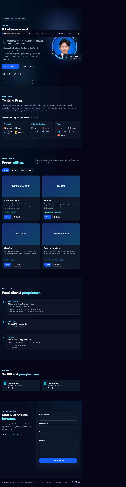
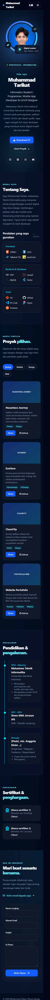

# Latihan 3 — Landing Page Portofolio

## Identitas Mahasiswa

| Keterangan | Data |
|---|---|
| Nama | Muhammad Tarikat |
| NPM | 24312205 |
| Kelas | IF 24 Cx |
| Branch | `Lat-3_LandingPage` |

## Deskripsi

Landing page portofolio dibuat dengan Laravel dan Tailwind CSS 4 melalui Vite.
Halaman mencakup navigasi responsif desktop/mobile, hero, profil, skills,
proyek, pengalaman, sertifikat, formulir kontak, dan footer.

## Menjalankan Proyek

Pastikan PHP, Composer, Node.js/npm, dan MySQL tersedia. Sesuaikan koneksi
database lokal di `.env`, lalu jalankan:

```sh
composer install
npm install
php artisan migrate
npm run build
php artisan serve
```

Buka `http://127.0.0.1:8000`. Untuk pengembangan frontend gunakan `npm run dev`
di terminal terpisah.

## Bukti Tampilan

**Desktop (1280px):**



**Mobile (375px):**


