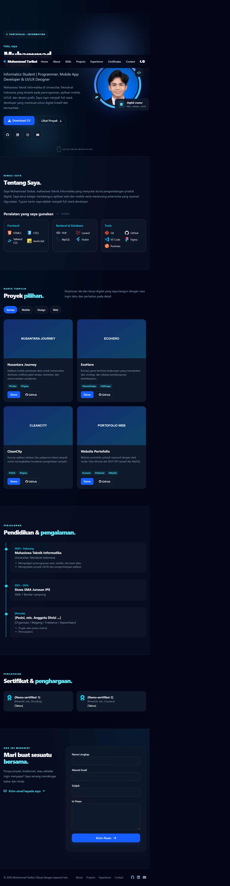
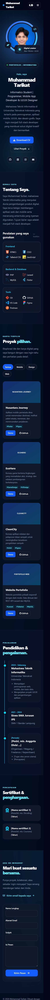

# Latihan 2 — Website Portfolio dengan FrontEnd Framework Tailwind

## Identitas Mahasiswa

| Keterangan | Data |
|---|---|
| Nama | Muhammad Tarikat |
| NPM | 24312205 |
| Kelas | IF 24 Cx |
| Branch | `Lat-2_Portfolio_Tailwind` |

## Deskripsi

Website portfolio responsif ini dibuat dengan Laravel Blade dan Tailwind CSS
v4. Tailwind diproses oleh Vite; halaman menggunakan utility classes untuk
layout, warna, jarak, tipografi, komponen, dan breakpoint responsive.

Halaman mencakup navigasi desktop dan mobile, hero/profile, skills, proyek,
pengalaman, sertifikat, formulir kontak, footer, serta pilihan tema gelap dan
terang. Data bagian portfolio dimuat melalui API Laravel, sehingga database
perlu diisi dengan seeder agar semua bagian tampil.

## Teknologi

- Laravel Blade untuk struktur halaman
- Tailwind CSS v4 dan Vite untuk styling dan bundling
- JavaScript untuk navigasi, tema, data API, dan formulir kontak
- MySQL untuk data portfolio

## Menjalankan Proyek

Pastikan PHP 8.3+, Composer, Node.js/npm, dan MySQL tersedia.

1. Salin `.env.example` menjadi `.env`.
2. Buat database MySQL lokal, lalu isi `DB_*` di `.env`.
3. Dari root proyek, jalankan:

```sh
composer install
php artisan key:generate
npm install
php artisan migrate
php artisan db:seed
npm run build
php artisan serve
```

Buka `http://127.0.0.1:8000`. Untuk pengembangan frontend dengan reload
otomatis, jalankan `npm run dev` di terminal terpisah.

Seeder mengisi data contoh untuk portfolio. Gunakan hanya database latihan;
jangan jalankan `php artisan migrate:fresh --seed` pada database yang berisi
data penting karena perintah tersebut menghapus semua tabel.

## Bukti Tampilan

**Desktop (1280px):**



**Mobile (375px):**



## Pemeriksaan

Pastikan Tailwind terbangun dan aplikasi dapat dibuka:

```sh
npm run build
php artisan route:list
```

Branch tugas:
[Lat-2_Portfolio_Tailwind](https://github.com/muhammadtarikat-crypto/portofolio/tree/Lat-2_Portfolio_Tailwind)
