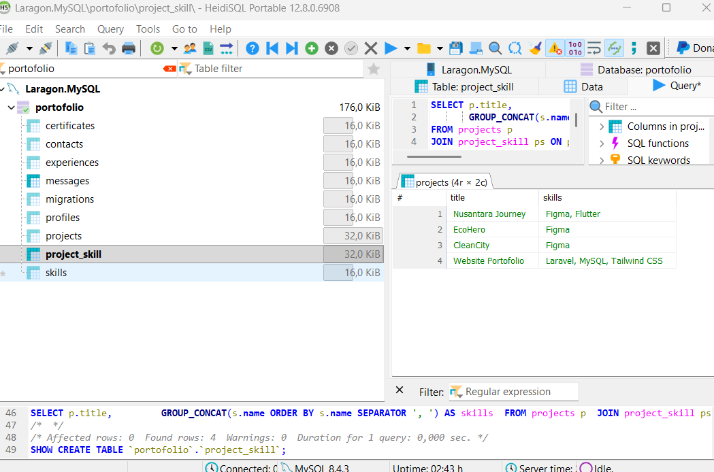
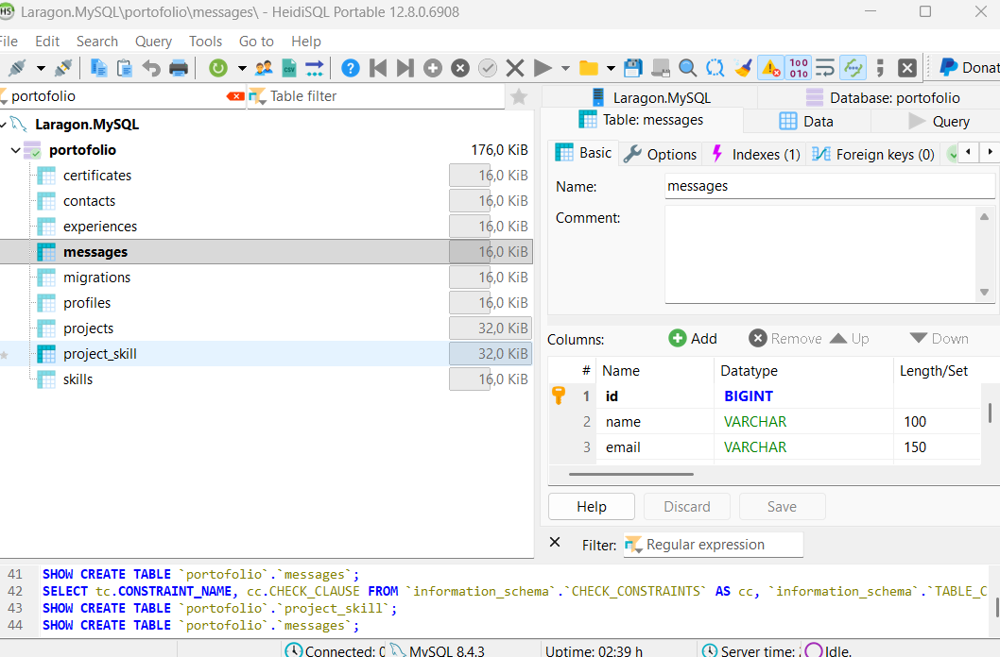

# Latihan 4b — Database dan Model

## Identitas Mahasiswa

| Keterangan | Data |
|---|---|
| Nama | Muhammad Tarikat |
| NPM | 24312205 |
| Kelas | IF 24 Cx |
| Branch | `Lat-4b_DatabaseModel` |

## Database

Database MySQL aktif bernama `portofolio`. Migrasi Latihan 4b menambahkan
`project_skill` dan `messages` tanpa menghapus tabel atau data yang sudah ada.
Tabel lama `contacts` tetap dipertahankan.

## Tujuh Tabel Inti

| Tabel | Kolom utama / relasi |
|---|---|
| `profiles` | `name`, `headline`, `bio`, `photo`, `email`, tautan sosial, `cv_url` |
| `skills` | `name`, `category`, `icon`, `sort` |
| `projects` | `title`, `category`, `description`, `image`, `tags`, tautan demo/repositori |
| `project_skill` | `project_id` → `projects.id`, `skill_id` → `skills.id`; primary key gabungan |
| `experiences` | `type`, `title`, `institution`, `period`, `details`, `sort` |
| `certificates` | `name`, `issuer`, `year`, `sort` |
| `messages` | `name`, `email`, `subject`, `message` |

Model `Project` memiliki relasi `skills()` dan model `Skill` memiliki relasi
`projects()`, keduanya many-to-many melalui tabel pivot `project_skill`.
Foreign key pivot menghapus relasi terkait ketika project atau skill
dihapus.

## Seeder

`ProjectSkillSeeder` menghubungkan proyek dengan skills tanpa menduplikasi
profil atau proyek yang sudah ada. Jalankan migrasi terlebih dahulu, lalu
seeder khusus ini:

```sh
php artisan migrate
php artisan db:seed --class=ProjectSkillSeeder
```

Jangan jalankan `php artisan migrate:fresh --seed` pada database yang memiliki
data penting karena perintah tersebut menghapus semua tabel.

Relasi yang sudah terpasang pada data proyek:

| Proyek | Skills |
|---|---|
| Nusantara Journey | Flutter, Figma |
| EcoHero | Figma |
| CleanCity | Figma |
| Website Portofolio | Laravel, MySQL, Tailwind CSS |

## Bukti Database dan Relasi

Screenshot HeidiSQL berikut menunjukkan database, tabel `project_skill`,
query, serta hasil relasi project dan skills:



Screenshot struktur tabel `messages`:



Screenshot `messages` yang tersedia hanya menampilkan bagian atas daftar
kolom. Jika diperlukan, ambil screenshot tambahan yang memperlihatkan semua
kolom tabel.

## Verifikasi dengan Tinker

Jalankan perintah berikut untuk melihat skill pertama milik project dengan
ID 1:

```sh
php artisan tinker --execute 'dump(App\Models\Project::find(1)->skills->first()->name);'
```

Hasil pada database aktif: `"Flutter"`. Screenshot terminal Tinker belum
tersedia; tambahkan jika bukti screenshot Tinker diwajibkan.
